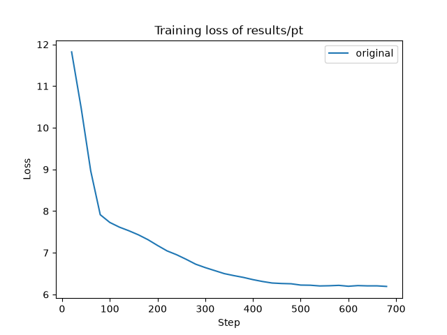
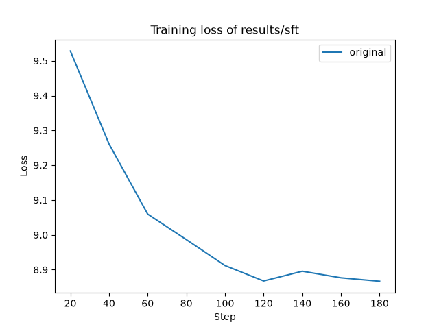
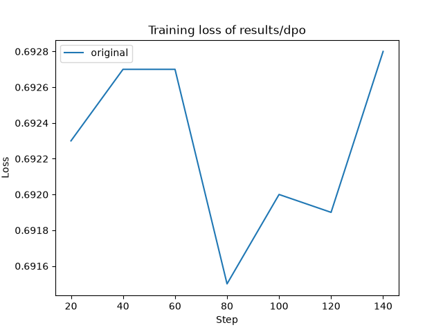

# mini_qwen 单卡复现手册

从零训练一个 1B 参数的中文 LLM，走完**预训练(PT) → 微调(SFT) → 直接偏好优化(DPO)** 三个阶段。

这份文档面向两类读者：

- **想跑通的人** —— 照着第 4、5、11 节做，命令可以直接复制。
- **想学明白的人** —— 第 6、7、12 节讲清楚三个阶段在数据和目标上的本质差异，
  以及新旧版 trl/transformers 之间那些"不报错但会训错"的坑。第 13 节给了阅读顺序。

> 本仓库是 [qiufengqijun/mini_qwen](https://github.com/qiufengqijun/mini_qwen) 的 fork。
> 原项目用 6×H800 训练 16B token；本 fork 把代码适配到新版依赖，并在**单卡**上完整跑通了全流程。
> 原作者的完整实验记录与分析保留在 [README.md](README.md) 里，很值得一读，
> 但其中的依赖版本号和部分命令已不适用，**以本文档为准**。

## 目录

- [1. 这个项目在做什么](#1-这个项目在做什么)
- [2. 项目结构](#2-项目结构)
- [3. 环境](#3-环境)
- [4. 五分钟验证：先把流程跑通](#4-五分钟验证先把流程跑通)
- [5. 数据准备](#5-数据准备)
- [6. 数据处理逻辑](#6-数据处理逻辑)
- [7. 模型结构](#7-模型结构)
- [8. 模型训练](#8-模型训练)
- [9. 训练结果](#9-训练结果)
- [10. 推理与评估](#10-推理与评估)
- [11. 完整复现命令](#11-完整复现命令)
- [12. 代码适配说明](#12-代码适配说明)
- [13. 新人学习路径](#13-新人学习路径)
- [14. 避坑清单](#14-避坑清单)
- [15. 已知限制](#15-已知限制)
- [16. 仓库卫生与 .gitignore](#16-仓库卫生与-gitignore)

---

## 1. 这个项目在做什么

一句话：**拿 Qwen2.5-0.5B-Instruct 的配置当骨架，把它改大到 1B，权重全部随机初始化，然后从零训起。**

不加载任何预训练权重——这是本项目和"微调一个现成模型"的根本区别，也是它适合学习的原因：
你能完整看到一个模型从随机噪声（loss ≈ 11.9，等于在 151936 个词表 token 上瞎猜）
一路降到 6.19 的过程。

三个阶段各自在做什么：

| 阶段 | 数据形态 | 训练目标 | loss 落在哪些 token 上 |
|---|---|---|---|
| **PT** 预训练 | 纯文本 | 学语言本身：给定前文预测下一个词 | **全部** token |
| **SFT** 微调 | 问答对 | 学会"被问了要回答"这件事 | **只有助手回复**，问题部分掩码掉 |
| **DPO** 偏好优化 | 同一问题的优劣两个回答 | 学会"同样是回答，哪个更好" | 用 chosen/rejected 的对数概率差构造偏好损失 |

三者的数据处理方式差异很大，这直接决定了训练吞吐（PT 最快、DPO 最慢），
细节见[第 6 节](#6-数据处理逻辑)。

---

## 2. 项目结构

```
mini_qwen/
├── mini_qwen_pt.py          预训练脚本
├── mini_qwen_sft.py         微调脚本
├── mini_qwen_dpo.py         直接偏好优化脚本
├── mini_qwen_eval.py        推理/对话脚本
│
├── run.sh                   一键入口：smoke / pt / sft / dpo / eval / all
├── prepare.sh               数据集下载命令（modelscope）
├── requirements.txt         实测可用的依赖版本
├── accelerate_config.yaml   多卡配置（DeepSpeed ZeRO-2，单卡用不到）
│
├── RUNBOOK.md               本文档
├── README.md                原作者的完整实验记录与分析
│
├── mini_data/               仓库自带的小样本数据（1.8M），免下载跑通流程用
│   ├── pt/  sft/  dpo/
├── models/
│   └── Qwen2.5-0.5B-Instruct/   只有 config 和 tokenizer，无权重（PT 不需要权重）
├── utils/
│   ├── demo_view_data.py    查看三份数据的字段结构
│   ├── save_mini_data.py    从完整数据切出 mini_data
│   └── plot_losses.py       从日志解析并绘制 loss 对比曲线
└── images/                  loss 曲线图
    ├── training_loss_*.png      原作者 6×H800 的实验结果
    └── runbook_*_loss.png       本 fork 单卡的实测结果
```

运行后会生成（均已 gitignore）：

```
data/      prepare.sh 下载的数据集
results/   训练产物（模型权重、checkpoint、loss 曲线）
logs/      训练日志
```

> **`demo/` 去哪了？** 原项目有一个 `demo/` 目录，装着三个把参数调小的脚本副本，
> 用途是在小显存上跑通流程。本 fork 给主脚本加了环境变量开关
> （`DATA_DIR` / `MAX_SAMPLES` / `BLOCK_SIZE` / `BATCH_SIZE` 等），
> 一份代码就能覆盖这个需求，`demo/` 因此删除——维护两份会漂移，
> 事实上原 `demo/` 里的代码在新版依赖上同样是坏的。
> 对应命令见 `bash run.sh smoke` 和[第 8.1 节](#81-环境变量开关)。

---

## 3. 环境

### 实测版本

下列组合是 2026-09 在单张 H200 上完整跑通全流程的版本，已写入 `requirements.txt`：

| 项目 | 版本 |
|---|---|
| Python | 3.13.12 |
| torch | 2.10.0+cu128 |
| transformers | 4.57.6 |
| trl | 1.2.0 |
| datasets | 4.8.4 |
| accelerate | 1.13.0 |
| tokenizers | 0.22.2 |
| flash_attn | 2.8.3 |
| modelscope | 1.36.3 |
| matplotlib | 3.11.2 |
| GPU | 1 × NVIDIA H200 143GB（driver 570.86.15 / CUDA 12.8） |
| CPU / 内存 | 192 核 / 96GB |

```bash
pip install -r requirements.txt
pip install flash-attn --no-build-isolation   # 需单独装，要先有 torch 和 CUDA toolchain
```

### 版本下限

脚本用到的新版 API 有硬性下限，装低了会直接报错：

- **transformers >= 4.56** —— `from_pretrained` / `from_config` 的 `dtype=` 参数
  （旧版叫 `torch_dtype=`，4.56 起改名）
- **trl >= 1.0** —— `processing_class=`、`SFTConfig.completion_only_loss`、
  `max_length` 移入 config

原项目 README 要求的 `trl==0.11.4` + `transformers==4.45.0` **与本仓库代码不兼容**，
迁移细节见[第 12 节](#12-代码适配说明)。

### 依赖自检

装完先跑这段，确认 flash-attn 真的能在你的卡上工作（装上不等于可用）：

```bash
python -c "
import torch, transformers, trl
from flash_attn import flash_attn_func
q = torch.randn(1, 8, 4, 64, device='cuda', dtype=torch.bfloat16)
print('torch', torch.__version__, '| transformers', transformers.__version__, '| trl', trl.__version__)
print('flash_attn OK:', flash_attn_func(q, q, q).shape)
"
```

报错也不影响使用——把脚本里的 `attn_implementation="flash_attention_2"` 改成 `"sdpa"`，
eval 脚本可直接 `--attn sdpa`。代价是速度慢一些、显存多一点。

### 关于多卡

`accelerate_config.yaml` 配的是 DeepSpeed ZeRO-2 + 6 卡。要用多卡需要：

```bash
pip install deepspeed                          # requirements.txt 里默认注释掉了
# 再把 accelerate_config.yaml 的 num_processes 改成你的实际 GPU 数
accelerate launch --config_file accelerate_config.yaml mini_qwen_pt.py
```

**本文档全程单卡，多卡路径未实测。**

---

## 4. 五分钟验证：先把流程跑通

在下载几百 G 数据之前，先用仓库自带的 `mini_data/` 把三个阶段串一遍，
确认环境和代码链路没问题：

```bash
bash run.sh smoke
```

它做的事：用 `mini_data/` 的几百条样本，以极小的 batch 和序列长度
依次跑 pt → sft → dpo，产物写到 `/tmp/mini_qwen_smoke`。

**输出是乱码属于正常现象**——只训了几百条样本，这一步只验证流程能不能通，不看效果。

看到这行就说明全通了：

```
>>> 冒烟测试通过。模型输出是乱码属正常，只训了几百条样本
```

---

## 5. 数据准备

三份数据都来自魔搭（ModelScope）上智源（BAAI）开源的数据集。

### 5.1 下载

完整下载用 `bash prepare.sh`（预训练数据约 40G）。
单卡跑不完那么多，**建议先下子集**：

```bash
# 预训练：只取"住宿餐饮酒店-中文-高质量"一个行业
modelscope download --dataset 'BAAI/IndustryCorpus2' \
    --include 'accommodation_catering_hotel/chinese/high*' --local_dir 'data/pt'

# 微调：Infinity-Instruct 的 7M 取前 3 个文件、Gen 取前 2 个文件
modelscope download --dataset 'BAAI/Infinity-Instruct' \
    --include '7M/train-0000[0-2]*' --local_dir 'data/sft'
modelscope download --dataset 'BAAI/Infinity-Instruct' \
    --include 'Gen/train-0000[0-1]*' --local_dir 'data/sft'

# 偏好：Infinity-Preference 全量（本身就不大）
modelscope download --dataset 'BAAI/Infinity-Preference' --local_dir 'data/dpo'
```

### 5.2 本次实际下载的量

合计约 1.15G：

| 文件 | 大小 | 行数 |
|---|---|---|
| `data/pt/accommodation_catering_hotel/chinese/high/rank_00000.parquet` | 371M | 94,201 |
| `data/sft/7M/train-0000{0,1,2}-of-00075.parquet` | 78M × 3 | 100,000 × 3 |
| `data/sft/Gen/train-0000{0,1}-of-00015.parquet` | 187M + 188M | 100,000 × 2 |
| `data/dpo/train-00000-of-00001.parquet` | 206M | 59,338 |
| `data/dpo/test-00000-of-00001.parquet` | 350K | 100 |

脚本的 `find_files()` 只会扫描实际存在的目录，所以下子集不需要改代码。

### 5.3 数据长什么样

```bash
python utils/demo_view_data.py    # 打印三份数据各一条样本
```

**预训练（IndustryCorpus2）** —— 脚本只读 `text` 字段，其余质量分列忽略：

```
text: string                     ← 只用这个
alnum_ratio, perplexity, quality_score, ... : double
_id: int64,  industry_type: string
```

**微调（Infinity-Instruct）** —— 脚本只读 `conversations`：

```
conversations: list<struct<from: string, value: string>>
```

`from` 实测只有 `human` 和 `gpt` 两种（抽样 2000 条：各 2455 次）。
轮数以单轮问答为主：2000 条里 1849 条是 2 轮，其余为 4~30 轮的多轮对话。

**偏好（Infinity-Preference）**：

```
prompt: string
chosen:   list<struct<content: string, role: string>>   ← [0]=user, [1]=assistant
rejected: list<struct<content: string, role: string>>
```

### 5.4 不下载也能学

`mini_data/`（1.8M）是从上述数据切出来的小样本，三个训练脚本都支持
`DATA_DIR=mini_data`，用于快速实验：

```bash
DATA_DIR=mini_data MAX_SAMPLES=100 BLOCK_SIZE=256 BATCH_SIZE=4 GRAD_ACCUM=2 \
    OUTPUT_PATH=/tmp/t python -u mini_qwen_pt.py
```

---

## 6. 数据处理逻辑

**这一节是理解三个阶段差异的关键。** 同样是喂文本给模型，三个阶段的组织方式完全不同。

### 6.1 预训练：序列拼接 + 定长分块

`mini_qwen_pt.py` 的 `preprocess_dataset()`：

1. 每篇文档末尾追加 `<|im_end|>`
2. 分词（`add_special_tokens=False`）
3. 把整批 token id **首尾相接拼成一条长序列**
4. 按 `block_size=1024` 切成等长块，末尾不足一块的丢弃

这是标准的 packing：**没有 padding，每个 token 都参与 loss**，GPU 利用率最高。
代价是一篇文档可能被切断到两个 block，一个 block 里也可能混有两篇不相关的文档
（靠 `<|im_end|>` 分隔）。

实测：**94,201 篇文档 → 132,802 个 block → 135,989,248 个 token（约 1.36 亿）**。

标签由 `DataCollatorForLanguageModeling(mlm=False)` 生成，即 `labels = input_ids`，
shift 由模型内部完成，做的是纯自回归续写。

### 6.2 微调：prompt-completion，只在回复上算 loss

SFT 的核心是**问题部分不算 loss**——模型不需要学会"生成问题"，只需要学会"根据问题生成回答"。

数据整理成：

```python
prompt     = f"<|im_start|>user\n{human_text.strip()}<|im_end|>\n<|im_start|>assistant\n"
completion = f"{gpt_text.strip()}<|im_end|>"
```

配合 `SFTConfig(completion_only_loss=True)`，trl 会分别对 `prompt` 和
`prompt + completion` 分词，用两者的长度差构造 `completion_mask`。

实测校验（一条样本的真实掩码结果）：

```
完整序列:        '<|im_start|>user\n你好<|im_end|>\n<|im_start|>assistant\n你好！很高兴见到你。<|im_end|>'
参与loss的token: '你好！很高兴见到你。<|im_end|>'
被掩码的token:   '<|im_start|>user\n你好<|im_end|>\n<|im_start|>assistant\n'
```

> **原项目用的 `DataCollatorForCompletionOnlyLM` 已从 trl 1.x 删除**，
> 它的做法是在 collator 里搜索 `<|im_start|>assistant\n` 的位置再掩码。
> 换成 trl 原生的 prompt-completion 格式后语义等价，见[第 12.2 节](#122-datacollatorforcompletiononlylm-已从-trl-删除sft直接崩)。

多轮对话的处理沿用原脚本：循环里不断覆盖 `human_text` / `gpt_text`，
因此**只保留最后一轮问答**。92% 的样本本就是单轮，影响有限。

#### `.strip()` 不是可选的 ⚠️

`gpt_text` 首尾的空白会和模板里的换行**合并成不同的 token**，
导致 `prompt` 的 token 序列不再是 `prompt + completion` 的前缀，掩码边界随之错位。
**trl 只打一条 warning 然后继续训**，不注意就会用错误的掩码训完整个流程。

实测 2000 条样本中 **127 条**触发；加 `.strip()` 后归零。

SFT 阶段**不做 packing**（`packing=False`，与原项目一致），每条样本独立 padding
到 batch 内最长长度——这是 SFT 吞吐明显低于 PT 的主要原因，见[第 9.4 节](#94-吞吐差异与规模取舍)。

### 6.3 直接偏好优化：标准偏好三元组

```python
prompt   = f"<|im_start|>user\n{prompt.strip()}<|im_end|>\n<|im_start|>assistant\n"
chosen   = f"{chosen[1]['content'].strip()}<|im_end|>"
rejected = f"{rejected[1]['content'].strip()}<|im_end|>"
```

`.strip()` 的理由同上。DPOTrainer 内部会自动复制一份**冻结的参考模型**，
用策略模型与参考模型在 chosen/rejected 上的对数概率差构造偏好损失。
因此显存约为 SFT 的两倍，且每步要跑 4 次前向（策略/参考 × chosen/rejected），
吞吐最低。

---

## 7. 模型结构

不加载任何预训练权重，而是**以 Qwen2.5-0.5B-Instruct 的配置为骨架、扩大规模后随机初始化**。
仓库里 `models/Qwen2.5-0.5B-Instruct/` 只有 config 和 tokenizer（没有权重），
这对预训练来说足够——`AutoModelForCausalLM.from_config()` 不需要权重。

| 配置项 | Qwen2.5-0.5B-Instruct | mini_qwen |
|---|---|---|
| `hidden_size` | 896 | **1024** |
| `num_hidden_layers` | 24 | **48** |
| `num_attention_heads` | 14 | **16** |
| `num_key_value_heads` | 2 | **4** |
| `intermediate_size` | 4864 | 4864（沿用） |
| `vocab_size` | 151936 | 151936（沿用） |
| `tie_word_embeddings` | true | true（沿用） |

实测参数量 **998,810,624（1.00B）**，bf16 权重文件 1.99GB。
注意力用 `flash_attention_2`，精度 bf16。

> ⚠️ **改层数必须同步改 `layer_types`**
>
> transformers ≥ 4.54 会在 `AutoConfig.from_pretrained()` 时按**原始层数**生成
> 一个 `layer_types` 列表。脚本把 `num_hidden_layers` 从 24 改成 48 后这个列表
> 还是 24 项，建模时按层号索引会直接 `IndexError: list index out of range`：
>
> ```python
> if getattr(config, "layer_types", None) is not None:
>     config.layer_types = ["full_attention"] * config.num_hidden_layers
> ```
>
> 用 `full_attention` 是因为该 config 里 `use_sliding_window: false`，原始 24 项也全是它。

---

## 8. 模型训练

### 8.1 环境变量开关

三个训练脚本都支持环境变量覆盖，**不设置时的默认值与原脚本一致**。
这套开关取代了原项目的 `demo/` 目录：

| 变量 | 默认值 | 作用 |
|---|---|---|
| `DATA_DIR` | `data` | 数据根目录，设 `mini_data` 可秒级试跑 |
| `MAX_SAMPLES` | `0` | 限制样本数，`0` 表示全部 |
| `NUM_PROC` | `16` | `dataset.map` 并行进程数 |
| `BATCH_SIZE` | pt/sft `12`、dpo `4` | `per_device_train_batch_size` |
| `GRAD_ACCUM` | `16` | `gradient_accumulation_steps` |
| `EPOCHS` | pt `1`、sft/dpo `3` | `num_train_epochs` |
| `BLOCK_SIZE` | `1024` | 仅 pt：分块长度 |
| `MAX_LENGTH` | `1024` | 仅 sft/dpo：截断长度 |
| `MODEL_PATH` | 见下 | 输入模型路径 |
| `OUTPUT_PATH` | `results/{pt,sft,dpo}` | 输出目录 |
| `REPORT_TO` | `none` | 上报后端，可设 `wandb` / `tensorboard` |

`MODEL_PATH` 默认值：pt 用 `models/Qwen2.5-0.5B-Instruct`（只读 config），
sft 用 `results/pt`，dpo 用 `results/sft`。

### 8.2 启动

```bash
bash run.sh pt     # 预训练
bash run.sh sft    # 微调
bash run.sh dpo    # 直接偏好优化
bash run.sh all    # 三个阶段依次跑
```

`run.sh` 已经处理好了单卡默认值、日志重定向和两个容易踩的细节：

- **`python -u`** —— 不加的话 stdout 是块缓冲的，重定向到日志后可能几十分钟看不到一行，
  极易误判成卡死（第一次跑 pt 时就被这个坑到，30 分钟日志只有 3 行）
- **`TQDM_DISABLE=1`** —— 否则日志被进度条的 `\r` 刷新记录塞满

想自己控制参数就直接调脚本：

```bash
TQDM_DISABLE=1 MAX_SAMPLES=20000 BATCH_SIZE=24 GRAD_ACCUM=8 NUM_PROC=32 \
    nohup python -u mini_qwen_sft.py > logs/run_sft.log 2>&1 &
```

### 8.3 本次使用的超参

学习率、warmup、调度器都沿用原脚本，只调整了 batch 切分
（原项目是 6 卡各 12，单卡改成 24×8，等效 batch 仍为 192）：

| | pt | sft | dpo |
|---|---|---|---|
| 初始模型 | 随机初始化 | `results/pt` | `results/sft` |
| learning_rate | 1e-4 | 1e-5 | 5e-7 |
| lr_scheduler | cosine | cosine | cosine |
| warmup_ratio | 0.1 | 0.1 | 0.1 |
| epochs | 1 | 3 | 3 |
| per_device_batch | 24 | 24 | 8 |
| grad_accum | 8 | 8 | 8 |
| 等效 batch | 192 | 192 | 64 |
| 序列长度 | 1024 | 1024 | 1024 |
| 精度 | bf16 | bf16 | bf16 |
| 样本数 | 132,802 block | 12,000 条 | 3,000 条 |
| 保存策略 | `save_steps=100000` | 每 epoch | 每 epoch |

---

## 9. 训练结果

### 9.1 汇总

| 阶段 | 训练量 | 步数 | 耗时 | 吞吐 | loss |
|---|---|---|---|---|---|
| pt | 132,802 block × 1024 = **1.36 亿 token**，1 epoch | 692 | 76 min | 29.13 样本/s | 11.82 → **6.19** |
| sft | 12,000 条 × 3 epoch，1,485 万 token | 189 | 58 min | 10.34 样本/s | 9.53 → **8.87** |
| dpo | 3,000 条 × 3 epoch，1,014 万 token | 141 | 38 min | 3.90 样本/s | 0.6923 → **0.6928** |

流水线总耗时 **2 小时 52 分**（10,347 秒）。

### 9.2 loss 曲线

<table>
<tr><td align="center"><b>PT</b></td><td align="center"><b>SFT</b></td><td align="center"><b>DPO</b></td></tr>
<tr>
<td></td>
<td></td>
<td></td>
</tr>
</table>

**pt**（每 20 步记录一次，下面每 5 条取 1 条）：

```
11.82 → 7.62 → 7.05 → 6.57 → 6.31 → 6.22 → 6.21
```

起点 11.82 几乎正好是 `ln(151936) = 11.93`，即在整个词表上均匀瞎猜——
这正是随机初始化该有的样子。降到 6.19 说明模型确实学到了东西。

**sft**（`mean_token_accuracy` 是助手回复 token 的预测准确率）：

| step | 20 | 40 | 60 | 80 | 100 | 120 | 140 | 160 | 180 |
|---|---|---|---|---|---|---|---|---|---|
| loss | 9.53 | 9.26 | 9.06 | 8.99 | 8.91 | 8.87 | 8.90 | 8.88 | 8.87 |
| token_acc | 0.051 | 0.066 | 0.076 | 0.080 | 0.082 | 0.086 | 0.086 | 0.086 | 0.087 |

**dpo**（`rewards/accuracies` 是 chosen 得分高于 rejected 的比例）：

| step | 20 | 40 | 60 | 80 | 100 | 120 | 141 |
|---|---|---|---|---|---|---|---|
| accuracies | 0.505 | 0.500 | 0.495 | 0.530 | 0.516 | 0.526 | 0.482 |
| margins | 0.0020 | 0.0011 | 0.0011 | 0.0036 | 0.0027 | 0.0029 | 0.0033 |

DPO 的 loss 几乎不动（0.6923 → 0.6928，`ln2 ≈ 0.693`）、`rewards/accuracies`
在 0.5 附近震荡，这是**预期结果而非 bug**：底座模型还在乱吐 token，
对 chosen / rejected 两条回复根本没有偏好可言，DPO 自然学不到有效信号。
**要让 DPO 有意义，前提是 SFT 模型已经能说通顺的话。**

> 对比原作者 6×H800 / 16B token 的曲线见 `images/training_loss_*.png` 和 README 的"结果分析"章节。

### 9.3 产物

```
results/
├── pt/    7.5G   model.safetensors(1.99G) + checkpoint-692 + training_loss.png
├── sft/   19G    model.safetensors + checkpoint-{63,126,189}   # 每 epoch 一个
└── dpo/   19G    model.safetensors + checkpoint-{47,94,141}
```

合计约 **45G**。checkpoint 大是因为默认同时保存了优化器状态（1.9G 权重 + 3.8G 优化器）；
只想留权重就打开脚本里注释掉的 `save_only_model=True`。

### 9.4 吞吐差异与规模取舍

三个阶段单样本吞吐差了近 8 倍，原因直接对应[第 6 节](#6-数据处理逻辑)的数据处理方式：

| 阶段 | 吞吐 | 原因 |
|---|---|---|
| pt | 29.1 样本/s | 序列拼接 + 定长分块，零 padding，每个 token 都参与计算 |
| sft | 10.3 样本/s | `packing=False`，变长样本 padding 到 batch 内最长，实测填充率仅约 40% |
| dpo | 3.9 样本/s | 每步 4 次前向（策略/参考模型 × chosen/rejected） |

**本次为了当天跑完做了规模缩减**：sft 最初按 50,000 条起跑，实测约需 4.8 小时，
中止后降到 12,000 条；dpo 同理降到 3,000 条。这不是脚本限制，去掉 `MAX_SAMPLES` 就是全量。

单卡跑全量的估算：

| 阶段 | 全量规模 | 单卡估算耗时 |
|---|---|---|
| pt | 40G 数据 / 约 16B token | 约 **6 天**（149 小时） |
| sft | 500,000 条 × 3 epoch | 约 **40 小时** |
| dpo | 59,438 条 × 3 epoch | 约 **13 小时** |

原项目用 6×H800 跑 pt 只要 25 小时。想在单卡上提高 sft 吞吐，
可以考虑开 `group_by_length=True` 减少 padding 浪费（本次为不改变训练语义没有启用）。

### 9.5 显存占用

| 阶段 | 峰值显存 |
|---|---|
| pt（batch 24 × 1024） | 约 122G |
| sft（batch 24 × 1024） | 约 126G |
| dpo（batch 8 × 1024，含参考模型） | 约 94G |

**显存大头不是权重，是 logits。** 1B 模型 bf16 权重才 2G，但词表有 151936，
batch 24 × seq 1024 × vocab 151936 的 fp32 logits 单份就是 14.9G，
加上 loss 计算中的副本和 48 层激活，很快上百 G。

显存不够时优先调小 `BATCH_SIZE` 并同步调大 `GRAD_ACCUM`（保持等效 batch 不变），
例如 `BATCH_SIZE=12 GRAD_ACCUM=16`（原脚本默认值）。
README 提到 pt/sft 12G、dpo 14G 显存即可训练，对应的是更小的 batch 和序列长度。

---

## 10. 推理与评估

```bash
bash run.sh eval                                      # 交互式，默认加载 results/dpo
python mini_qwen_eval.py --model_path results/sft     # 指定模型
```

| 参数 | 默认值 | 说明 |
|---|---|---|
| `--model_path` | `results/dpo` | 模型路径 |
| `--base` | 关 | 预训练模型模式：直接续写，不套对话模板 |
| `--prompt` | 无 | 非交互模式，可重复传入多个问题；不传则进入交互模式 |
| `--max_new_tokens` | 512 | 生成长度 |
| `--attn` | `flash_attention_2` | 显卡不支持时设 `sdpa` / `eager` |

```bash
# 非交互，适合脚本化批量测试
python mini_qwen_eval.py --model_path results/sft --prompt "介绍一下北京" --prompt "1+1=?"

# 预训练模型用 --base（续写模式，不套 <|im_start|> 模板）
python mini_qwen_eval.py --model_path results/pt --base --prompt "北京是中国的"
```

### 本次实际输出

```
########## results/pt --base ##########
用户： 这家酒店的早餐怎么样？
助手： ,在酒店的酒店,酒店,酒店,酒店,酒店,酒店,酒店,酒店,酒店,...

########## results/sft ##########
用户： 这家酒店的早餐怎么样？
助手：  - - - - - - - - - - - - - - - - - - - - - - - -
```

**输出不通顺是训练量不足的必然结果，不是脚本 bug。** 原项目用 16B token 预训练，
本次只有 1.36 亿 token，差了两个数量级。

有个细节反过来证明训练确实生效了：pt 模型反复吐"酒店"——
本次预训练语料恰好只用了"住宿餐饮酒店"这一个行业，模型学到了该领域的高频词。
这也是 README"复读机现象"一节讨论的现象在极端欠训练下的表现。

### 验证脚本本身是否正确

想确认 eval 脚本（模板拼接、生成、解码）没问题，拿一个真实的小模型跑：

```bash
python mini_qwen_eval.py --model_path <某个真实的小模型路径> \
    --prompt "用一句话介绍北京" --max_new_tokens 120
```

实测用 Qwen3-0.6B 输出通顺中文，说明脚本链路正确，问题只在于 mini_qwen 自身欠训练。

---

## 11. 完整复现命令

```bash
# ---------- 0. 装依赖并自检 ----------
pip install -r requirements.txt
pip install flash-attn --no-build-isolation
python -c "
import torch, transformers, trl
from flash_attn import flash_attn_func
q = torch.randn(1, 8, 4, 64, device='cuda', dtype=torch.bfloat16)
print('torch', torch.__version__, '| transformers', transformers.__version__, '| trl', trl.__version__)
print('flash_attn OK:', flash_attn_func(q, q, q).shape)
"

# ---------- 1. 五分钟验证流程 ----------
bash run.sh smoke

# ---------- 2. 下载数据（子集约 1.15G，视网络 5~15 分钟） ----------
modelscope download --dataset 'BAAI/IndustryCorpus2' \
    --include 'accommodation_catering_hotel/chinese/high*' --local_dir 'data/pt'
modelscope download --dataset 'BAAI/Infinity-Instruct' \
    --include '7M/train-0000[0-2]*' --local_dir 'data/sft'
modelscope download --dataset 'BAAI/Infinity-Instruct' \
    --include 'Gen/train-0000[0-1]*' --local_dir 'data/sft'
modelscope download --dataset 'BAAI/Infinity-Preference' --local_dir 'data/dpo'

# ---------- 3. 训练（合计约 2 小时 52 分） ----------
bash run.sh pt      # 76 min
bash run.sh sft     # 58 min
bash run.sh dpo     # 38 min

# ---------- 4. 评估 ----------
python mini_qwen_eval.py --model_path results/pt  --base --prompt "这家酒店的早餐怎么样？" --max_new_tokens 40
python mini_qwen_eval.py --model_path results/sft        --prompt "这家酒店的早餐怎么样？" --max_new_tokens 40
python mini_qwen_eval.py --model_path results/dpo        --prompt "这家酒店的早餐怎么样？" --max_new_tokens 40
```

想跑全量：第 2 步换成 `bash prepare.sh`，第 3 步去掉 `run.sh` 里的 `MAX_SAMPLES`
默认值（或显式传 `MAX_SAMPLES=0`），耗时估算见[第 9.4 节](#94-吞吐差异与规模取舍)。

---

## 12. 代码适配说明

原脚本按 `transformers 4.45` / `trl 0.11.4` 编写，跨到 `4.57` / `1.2` 后有 5 处问题。
**其中 12.3 不报错但会静默训错，是最危险的一个。**

### 12.1 `config.layer_types` 与层数不同步（pt，直接崩）

transformers ≥ 4.54 按原始 24 层生成 `layer_types`，脚本改成 48 层后该列表没同步，
建模按层号索引报 `IndexError: list index out of range`。修复见[第 7 节](#7-模型结构)。

### 12.2 `DataCollatorForCompletionOnlyLM` 已从 trl 删除（sft，直接崩）

trl 1.x 移除了这个 collator。改用原生 prompt-completion 格式 +
`SFTConfig(completion_only_loss=True)`，已实测校验掩码等价，见[第 6.2 节](#62-微调prompt-completion只在回复上算-loss)。

### 12.3 分词边界错位导致掩码错误（sft/dpo，静默训错）⚠️

回复首尾空白与模板换行合并成不同 token，使 completion 掩码边界错位。
实测 2000 条中 127 条受影响。修复：对 `human_text` / `gpt_text` / `chosen` /
`rejected` / `prompt` 统一加 `.strip()`。

**trl 只打 warning 不报错**，不注意的话会以错误的掩码训完整个流程。

### 12.4 DPOTrainer / DPOConfig 参数迁移（dpo，直接崩）

| 原写法 | trl 1.2 写法 |
|---|---|
| `DPOTrainer(tokenizer=...)` | `DPOTrainer(processing_class=...)` |
| `DPOTrainer(max_length=...)` | 移入 `DPOConfig(max_length=...)` |
| `DPOTrainer(dataset_num_proc=...)` | 移入 `DPOConfig(dataset_num_proc=...)` |
| `DPOTrainer(max_prompt_length=...)` | **已移除**，trl 1.2 不再支持 |

SFTTrainer 同理：`max_seq_length` → `SFTConfig(max_length=...)`，
`packing` / `dataset_num_proc` 移入 config，`dataset_batch_size` 已移除，
`tokenizer=` → `processing_class=`。

### 12.5 wandb 自动检测导致训练无法启动（三个脚本，直接崩）

环境里装了 wandb 时，`Trainer` 会自动检测并索要 API key，没登录就抛
`wandb.errors.errors.UsageError: No API key configured`。
三个脚本都加了 `report_to=REPORT_TO`，默认 `none`；要用就 `REPORT_TO=wandb`（需先 `wandb login`）。

### 12.6 eval 脚本改为 argparse 驱动

原脚本有 11 行连续覆盖的 `model_path` 赋值（实际生效的只有最后一行），
且是死循环 `input()`，无法脚本化调用、Ctrl-D 会抛 `EOFError` 栈。
现改为 argparse，保留交互模式为默认，新增 `--prompt` / `--base` / `--attn`，
并补上 `pad_token_id` 和 `torch.no_grad()`。

### 12.7 其它改动

- `torch_dtype=` → `dtype=`（transformers 4.56+ 重命名）
- 数据目录找不到文件时抛 `FileNotFoundError` 并提示先下载数据，而不是让
  `load_dataset` 抛一个难懂的空文件列表错误
- 打印实际数据文件数和样本数，方便确认数据加载是否正确
- 加入[第 8.1 节](#81-环境变量开关)的环境变量开关，默认值与原脚本一致
- 删除 `demo/` 目录（已被环境变量开关取代，且其代码同样未适配）
- `run.sh` 从命令草稿改为可执行的分阶段脚本
- 新增 `requirements.txt`

### 12.8 一个可以忽略的告警

```
The tokenizer you are loading from 'results/pt' with an incorrect regex pattern:
... Mistral-Small-3.1-24B-Instruct-2503 ... You should set the `fix_mistral_regex=True` flag
```

这是 transformers 4.57 的**误报**。实测对比过原始 tokenizer 与保存后的 tokenizer，
对中英文、代码、特殊 token 各种输入的编码结果**逐 token 完全相同**：

```bash
python -c "
from transformers import AutoTokenizer
a = AutoTokenizer.from_pretrained('models/Qwen2.5-0.5B-Instruct')
b = AutoTokenizer.from_pretrained('results/pt')
tests = ['你好，世界！\nHello world 123', 'def f(x):\n    return x\n\n# done',
         '<|im_start|>user\n测试<|im_end|>\n<|im_start|>assistant\n']
print('identical:', all(a(t).input_ids == b(t).input_ids for t in tests))
"
```

---

## 13. 新人学习路径

如果目标是**看懂**而不只是跑通，建议按这个顺序：

**第一步：把流程跑通，建立直觉**

1. `bash run.sh smoke` —— 5 分钟，确认环境没问题
2. `python utils/demo_view_data.py` —— 看清三份数据长什么样

**第二步：理解三个阶段的本质差异**（本文档[第 6 节](#6-数据处理逻辑)）

带着这几个问题读代码：

- PT 为什么要把文档拼起来再切块？不拼会怎样？（答案在 9.4 的吞吐对比）
- SFT 为什么要把问题部分的 label 设成 -100？不设会怎样？
- DPO 为什么显存是 SFT 的两倍、吞吐只有 1/3？（参考模型 + 4 次前向）

**第三步：读代码，对照文档**

| 想搞懂 | 读这个文件 | 配合本文档 |
|---|---|---|
| 怎么从 config 造一个随机初始化的模型 | `mini_qwen_pt.py` 前 45 行 | 第 7 节 |
| 序列拼接分块怎么实现 | `mini_qwen_pt.py` 的 `preprocess_dataset()` | 第 6.1 节 |
| completion 掩码怎么生效 | `mini_qwen_sft.py` 的 `preprocess_dataset()` | 第 6.2 节 |
| DPO 数据要整理成什么样 | `mini_qwen_dpo.py` 的 `preprocess_dataset()` | 第 6.3 节 |
| 对话模板怎么拼 | `mini_qwen_eval.py` 的 `chat()` | 第 10 节 |

**第四步：自己动手改**

几个有价值的练习：

- 把 pt 的 `BLOCK_SIZE` 从 1024 改成 512，观察 block 数和 loss 曲线怎么变
- 在 sft 里把 `completion_only_loss` 关掉，对比 loss 曲线（会明显偏低，因为问题部分好预测）
- 给 sft 开 `group_by_length=True`，看吞吐能提多少
- 换一个行业的预训练语料，看 eval 时模型的"复读"内容会不会跟着变

**第五步：读原作者的分析**

[README.md](README.md) 里有尺度定律、复读机现象、微调阶段知识注入的讨论，
以及 6×H800 上的完整实验对比。那是本项目真正有价值的部分，本文档只负责让你能跑起来。

---

## 14. 避坑清单

1. **一定要用 `python -u`**。不加的话 stdout 块缓冲，`nohup` 日志可能几十分钟没有一行，
   极易误判成卡死。`run.sh` 已经处理。判断是否真在训练可以采样 GPU 利用率：
   ```bash
   for i in $(seq 1 10); do nvidia-smi --query-gpu=utilization.gpu,memory.used --format=csv,noheader; sleep 2; done
   ```
2. **`TQDM_DISABLE=1`**，否则日志被进度条刷新记录塞满。`run.sh` 已处理。
3. **`.strip()` 不能省**。见[第 12.3 节](#123-分词边界错位导致掩码错误sftdpo静默训错)，
   唯一一个不报错但会训错的问题。
4. **改 `num_hidden_layers` 必须同步改 `layer_types`**。见[第 7 节](#7-模型结构)。
5. **显存看 logits 不看权重**。1B 模型权重才 2G，但 151936 的词表让 logits 成为大头。
   OOM 时调小 `BATCH_SIZE`、同步调大 `GRAD_ACCUM` 保持等效 batch。
6. **先用 `mini_data` 跑通再上真数据**。`bash run.sh smoke` 五分钟能验证完整链路，
   比直接上全量数据等一小时才发现报错划算得多。
7. **多卡需要先装 deepspeed**，且 `accelerate_config.yaml` 的 `num_processes` 要改成实际卡数。
8. **不要把 `results/` 和 `data/` 提交进 git**，见[第 16 节](#16-仓库卫生与-gitignore)。

---

## 15. 已知限制

- **训练规模远小于原方案**：pt 1.36 亿 token（原方案 16B）、sft 12,000 条（原方案 9M）、
  dpo 3,000 条（原方案 60K）。因此模型输出不通顺，
  **本文档的目标是跑通流程和讲清原理，不是复现效果。**
- **预训练语料只有一个行业**（住宿餐饮酒店/中文/高质量），领域严重偏窄。
- **多轮对话被截断成单轮**：沿用原脚本逻辑，`conversations` 只保留最后一轮问答。
  92% 的样本本就是单轮，但多轮样本的前文信息被丢弃了。
- **DPO 阶段没有学到有效偏好信号**：`rewards/accuracies` 在 0.5 附近震荡，
  因为 SFT 底座还不能生成通顺文本。
- **多卡 + DeepSpeed 路径未实测**：本文档全程单卡。
- **没有自动化测试**：正确性靠手工校验（掩码等价性、tokenizer 一致性、边界统计）。

---

## 16. 仓库卫生与 .gitignore

跑完一轮流水线会产生约 **45G 训练产物 + 1.15G 数据集**，
稍不注意就会被 `git add .` 带进版本库。`.gitignore` 的原则是：
**大模型权重、大数据集、训练产物一律不入库，仓库只保留代码、配置、文档，
以及 `mini_data/` 里用于跑通流程的小样本数据。**

| 类别 | 规则 |
|---|---|
| 训练产物 | `results/` |
| 下载数据 | `data/` |
| 训练日志 | `logs/`、`output_*.log`、`nohup.out` |
| 模型权重（兜底） | `*.safetensors` `*.bin` `*.pt` `*.pth` `*.ckpt` `*.h5` `*.onnx` `*.gguf` 等 |
| 大数据文件 | `*.parquet` `*.arrow` `*.npy` `*.npz` `*.jsonl` 等 |
| 实验跟踪 | `wandb/`、`runs/`、`events.out.tfevents.*` |
| Python / 编辑器 | `__pycache__/`、`*.py[cod]`、`.venv/`、`.vscode/`、`.idea/` |

目录规则已覆盖全部大文件；按扩展名的规则是兜底，防止以后在别的目录手滑提交权重。

**一个必须保留的例外**：`mini_data/` 下 6 个小样本 parquet 是"不下载数据也能跑通"的
依赖项，会被 `*.parquet` 误伤，因此加了反向规则：

```gitignore
*.parquet
!mini_data/**/*.parquet
```

自查命令：

```bash
# 所有 >10M 的文件都已被忽略（无输出即通过）
find . -path ./.git -prune -o -type f -size +10M -print | while read f; do
    git check-ignore -q "$f" || echo "未忽略: $f"
done

# 已跟踪文件无一被误伤（无输出即通过）
git ls-files | while read f; do git check-ignore -q "$f" && echo "被误伤: $f"; done
```

> `.gitignore` 只对**未跟踪**的文件生效。若某个大文件已经被 `git add` 过，
> 需要先 `git rm --cached <file>` 把它从索引里移除，规则才会起作用。
